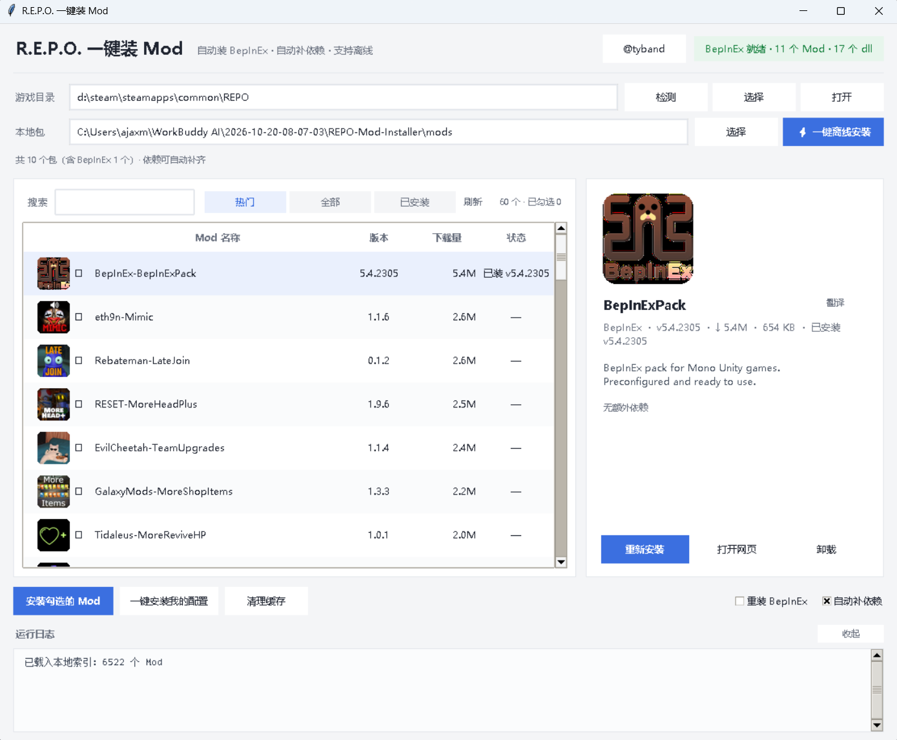
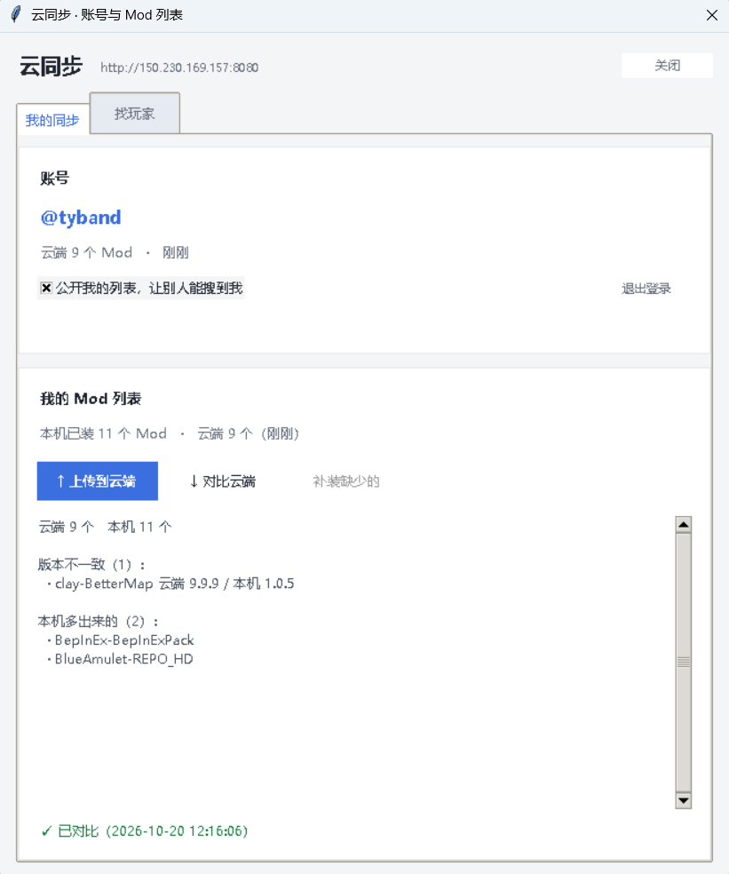
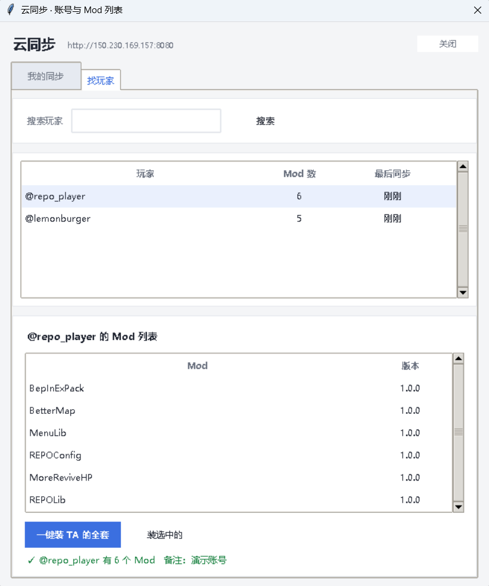

# R.E.P.O. 一键装 Mod

> 给《R.E.P.O.》用的图形化 Mod 安装器：自动装 BepInEx 前置、自动补依赖、自动认目录结构。到网吧换个机器，点一下就能装好整套 Mod。




---

## 这个工具解决什么问题

手动装 R.E.P.O. 的 Mod 有三层坑，每一步都得自己来：

**1. 得先装 BepInEx 框架**  
`BepInExPack` 压缩包解开后，要把 `BepInEx` 文件夹、`doorstop_config.ini`、`winhttp.dll` 一起拖进游戏根目录。少一个就不生效。

**2. Mod 之间有依赖链**  
装 `REPOLib` 要 `MenuLib`，装 `MoreShopItems` 要 `NoItemSpawnLimit`……漏装一个，游戏启动就报错。

**3. 每个包的内部结构都不一样**

| 包                               | 内部结构                                                | 该放哪                     |
| ------------------------------- | --------------------------------------------------- | ----------------------- |
| `BepInEx-BepInExPack`           | `BepInExPack/BepInEx/...` + `winhttp.dll`           | 游戏根目录（要剥掉外壳文件夹）         |
| `Zehs-REPOLib`                  | `plugins/REPOLib.dll`                               | `BepInEx/plugins/`      |
| `clay-BetterMap`                | `BetterMap.dll`（直接在根）                               | `BepInEx/plugins/<包名>/` |
| `PxntxrezStudio-No_Save_Delete` | `Plugins/NoSaveDelete.dll`（大写 P）                    | `BepInEx/plugins/<包名>/` |
| `toored-Chinese_Translation`    | 自带整套 `BepInEx/core`、`patchers`、`config/Translation` | 原样铺到游戏根目录               |

最后一个最容易翻车：汉化包如果被当成普通 Mod 塞进 `plugins/<包名>/` 子文件夹，翻译器就找不到自己的配置和翻译文件，**汉化直接失效**。

这些判断，工具全包了。

---

## 特性

- **自动定位游戏** —— 读注册表 + 解析 Steam 的 `libraryfolders.vdf`，多硬盘 Steam 库也能找到
- **自动装 BepInEx** —— 首次安装自动铺好前置框架，已装则跳过（不会覆盖你的配置）
- **依赖递归解析** —— 自动补齐 REPOLib / MenuLib 之类的依赖，版本冲突取最高
- **离线也补依赖** —— 本地安装时若发现缺依赖，勾选后自动联网下载，并**存回 `mods/`**，下次断网也能用
- **结构智能识别** —— 按包内实际结构决定落点，`plugins/`、`Plugins/`、`patchers/`、自带 `BepInEx/` 都能正确归类
- **离线安装** —— `mods/` 目录放好 zip，网吧不联网也能装
- **在线安装** —— 界面直接浏览 Thunderstore 全部 6500+ Mod，搜名字勾选即可
- **列表始终是最新的** —— 启动时先用本地缓存秒开，再后台从 Thunderstore API 同步一遍（日志会显示下载进度），不打断你正在看的详情
- **界面带图标** —— 列表和详情面板直接显示 Thunderstore 官方图标，选 Mod 不用只看名字猜
- **一键翻译** —— 详情面板点「翻译」，Mod 名字和英文简介立刻变中文，再点还原；名字走内置词表（不联网也准），简介走免费翻译接口
- **自动清旧版本** —— 同一个 Mod 装了新旧两个版本会导致重复加载、游戏闪退，每次安装自动清理
- **安装前备份** —— 首次安装会把原有 `BepInEx` 备份到 `data/backups/`
- **精确卸载** —— 按安装清单逐个文件删除，不留垃圾
- **云同步账号** —— 注册一个账号，把 Mod 清单存到云端；换机器一键对比补装，还能按用户名搜玩家、直接装别人那套

---

## 快速开始

### 方式一：用打包好的 EXE（网吧推荐）

在任意有 Python 的电脑上双击 `build-exe.bat`，得到 `dist/REPO-Mod-Installer.exe`。  
Mod 包和 Mod 列表索引都打在 exe 内部，**拷这一个文件就能用，目标机器不需要装 Python**。

exe 第一次运行会在自己旁边释放出三样东西：

| 释放出来的      | 用途                          |
| ---------- | --------------------------- |
| `config.json` | 配置（要改代理就改这个）                |
| `mods\`       | 内置的离线包，也可以往里面丢自己的 zip       |
| `data\`       | 索引缓存、图标缓存、安装记录              |

> **为什么索引要打进 exe**：早期版本只打了 mod 包，exe 拷到新机器上 `data\` 是空的，界面就是一张空列表——Thunderstore 在国内还经常连不上，看起来就像工具坏了。现在索引（6522 个包，gzip 后 2.5 MB）跟着 exe 走，第一次打开就有完整列表，联网时再自动更新。

### 方式二：源码运行

```bash
git clone https://github.com/<你的用户名>/repo-mod-installer.git
cd repo-mod-installer
pip install -r requirements.txt      # requests + 可选的 Pillow（图标更清晰）
```

双击 `启动.bat`（会自动挑选带 tkinter 的 Python 解释器），或直接：

```bash
python mod_installer.py
```

### 方式三：离线安装（网吧不联网）

1. 事先在 [Thunderstore](https://thunderstore.io/c/repo/) 下载需要的 zip
2. 按 `作者-Mod名-版本.zip` 命名，放进 `mods/` 文件夹
3. 把整个项目文件夹拷到 U 盘，到网吧双击 `启动.bat`
4. 点「⚡ 一键离线安装」

---

## 依赖是怎么自动解决的

Thunderstore 上每个 Mod 的 `manifest.json` 里都有 `dependencies` 字段，形如：

```json
{
  "name": "MoreShopItems_Updated",
  "version_number": "4.2.2",
  "dependencies": [
    "BepInEx-BepInExPack-5.4.2305",
    "HeroHanex-NoItemSpawnLimit-1.0.8"
  ]
}
```

工具就靠这个字段做**递归依赖闭包**——装 A 需要 B，装 B 又需要 C，会一路挖到底：

```
你装 MoreHead
  ↳ YMC_MHZ-MoreHead v1.4.5
    ↳ nickklmao-MenuLib v2.5.2      ← 自动补
    ↳ BepInEx-BepInExPack v5.4.2305 ← 自动补
```

**版本冲突**：同一个包被多个 Mod 要求不同版本时，取版本号最大的那个。例如一个要 `BepInEx 5.4.2100`、另一个要 `5.4.2305`，最终装 `5.4.2305`，日志会标出升级过程：

```
↑ BepInEx-BepInExPack 版本升级 5.4.2100 → 5.4.2305
```

### 三种安装方式下的行为

| 方式                      | 依赖处理                            |
| ----------------------- | ------------------------------- |
| **在线安装**（界面勾选）          | 自动解析 + 自动下载，无需干预                |
| **离线安装 + 勾选「自动补齐缺失依赖」** | 先装本地包，缺的依赖联网下载，**并保存进 `mods/`** |
| **离线安装 + 不勾选**（真断网）     | 只列出缺哪些，不阻断安装                    |

### 为什么要把依赖存回 `mods/`

你在家手动从官网下了一个新 Mod 丢进 `mods/`，它可能依赖 3 个别的包。第一次安装时工具联网补齐，同时把这 3 个 zip 也存进 `mods/`。

于是这个文件夹从此就是**自包含**的了——拷到网吧断网也能一次装完，不用再补。

日志里能清楚看到：

```
检查依赖关系…
缺失 → HeroHanex-NoItemSpawnLimit v1.0.8
发现 1 个缺失依赖，开始下载…
  下载 HeroHanex-NoItemSpawnLimit v1.0.8 … 完成 (0.03 MB)
  已存入本地包目录: HeroHanex-NoItemSpawnLimit-1.0.8.zip
[11/11] (依赖) HeroHanex-NoItemSpawnLimit v1.0.8
  已安装 1 个文件
```

---

## 界面说明

左边选 Mod，右边看详情，底部是日志——不用记路径，也不用记按钮顺序。

| 区域             | 说明                                                          |
| -------------- | ----------------------------------------------------------- |
| **游戏位置**       | 自动检测 R.E.P.O. 安装目录；检测不到可手动指定                                |
| **本地 Mod 包**   | 显示 `mods/` 里的包数量，「⚡ 一键离线安装」= 全部装一遍                          |
| **左：Mod 列表**   | 每行带 Thunderstore 官方图标、版本、下载量、安装状态；点行出详情，点 ☐ 勾选，双击切换勾选        |
| **右：详情面板**     | 112px 大图标 + 作者 / 版本 / 下载量 / 包体积 / 已装版本 + 官方简介 + 依赖清单 + 安装/打开网页/卸载 |
| **翻译按钮**       | 详情面板名字右边，点一下名字和简介变中文，按钮变成「还原」，再点回原文                       |
| **底部：运行日志**    | 每一步在做什么，出错原因也在这里；右上角「收起」可折叠，给列表腾地方                          |
| **右上角账号**      | 「登录 / 注册」→ 登录后变成 `@你的用户名`，点开是云同步窗口（见下文「云同步」）              |

几个细节：

- **图标是异步拉的** —— 列表先秒开，图标下载完再逐个贴上，不会因为联网慢卡住界面
- **自动选中第一行** —— 打开就有内容看，不用先猜哪一行能点
- **悬停高亮 + 状态胶囊** —— 顶部胶囊直接告诉你 BepInEx 就绪没有、装了几个 Mod、铺了几个 dll
- **窗口自适应** —— 按屏幕可用空间定尺寸，高 DPI（125% / 150% 缩放）下也不会超出屏幕被裁掉

| 按钮           | 作用                                          |
| ------------ | ------------------------------------------- |
| ⚡ 一键离线安装     | 装 `mods/` 里的全部包（缺依赖时按勾选自动补齐）                |
| 安装勾选的 Mod    | 装列表里勾选的（联网，自动补依赖）                           |
| 一键安装我的配置     | 装 `config.json` 中 `auto_install_list` 定义的整套 |
| 安装这个 / 重新安装  | 详情面板里的按钮，只装当前这一个                            |
| 打开网页         | 用浏览器打开该 Mod 的 Thunderstore 页面               |
| 卸载           | 按安装记录精确删除                                   |
| 清理缓存         | 清空 `data/cache/`                            |
| 重装 BepInEx   | BepInEx 损坏或想换版本时勾选                          |
| 自动补依赖        | 默认开启。断网时自动降级为仅提示，不会卡住                       |

> 想更清晰：`pip install Pillow` 会启用 LANCZOS 缩放 + 圆角图标。不装也能跑，只是图标是最近邻缩放的，边缘会有点硬。

---

## 翻译

点详情面板名字右边的「翻译」，名字和简介会变成中文，按钮变成「还原」，再点一次回英文。

- **名字走内置词表**：按社区 6522 个包的实际用词统计出来的，`MoreShopItems` → `更多商店物品`、`NoSaveDelete` → `无存档删除`、`MoreReviveHP` → `更多复活生命值`。**不联网**，所以又快又稳定。
- 词表覆盖不到的名字（`BepInExPack`、`REPOLib` 这类专有名词）才走在线翻译，翻不出来就保持原文，不会硬凑。
- **简介走免费接口**，按网络情况自动挑：

| 顺序 | 翻译源 | 什么时候用 | 说明 |
| --- | --- | --- | --- |
| 1 | **Google** | 配了 `proxy`，或探测到本机代理端口 | 译文最顺，但国内直连打不通 |
| 2 | **腾讯翻译君**（transmart） | 默认走这个 | 国内直连、不用 Key、不用注册，0.7 秒左右一条 |
| 3 | **MyMemory** | 前两个都失败 | 兜底，免费额度每天 5000 字符 |

> 日志里出现「Google 连不上（国内需代理），改用腾讯翻译君」是**正常现象**，不是故障——国内本来就连不上 Google。想用 Google 就在 `config.json` 里填 `"proxy": "http://127.0.0.1:7897"`。

- **译文缓存在** `data/translate_cache.json`：同一个 Mod 第二次点秒出，断网也能看。

> 名字用词表而不是机翻，是因为机翻对 `MoreShopItems` 这种连写标识符经常翻成半截（实测会翻成「商店项目」，把 More 丢了）。词表是确定性映射，不会出错。

---

## 云同步（账号 / 存档 Mod 列表 / 找玩家）

网吧的痛点不只是"要手动装"，还有"这台机器上装好的配置，下次换一台就没了"。云同步解决这个：

| 能力 | 说明 |
| --- | --- |
| **创建账号** | 点右上角「登录 / 注册」，用户名 3-20 位字母数字，密码至少 6 位。不需要邮箱，不需要验证码 |
| **存 Mod 列表** | 把当前这台机器的 Mod 清单（名字 + 版本）存到云端，换机器后一键对比、补装 |
| **手动同步** | 「↑ 上传到云端」推当前列表；「↓ 对比云端」拉下来跟本机比，列出**云端有本机没有**、**版本不一致**、**本机多出来**三类，缺的可以一键补装 |
| **找玩家** | 按用户名搜索，看对方装了哪些 Mod，可以「一键装 TA 的全套」或只装选中的几个 |
| **隐私开关** | 账号区有「公开我的列表」勾选框，取消后别人搜不到你，也看不了你的列表 |





### 同步的粒度

存的是**清单**，不是 Mod 文件。一条记录只有 `full_name` / `version` / `name`，几十 KB。装的时候按名字去 Thunderstore 取最新版，所以：

- 对方上传了旧版本，你装到的仍是最新兼容版本
- 云端只是"我装了什么"的备忘录，不承担分发 Mod 的责任（Mod 版权归作者）

### 服务器

后端在 `server/`，是一个单文件 FastAPI + SQLite 服务，1 核 1G 的小机器就能跑：

```
客户端 ──HTTP──> nginx :8080 ──> uvicorn 127.0.0.1:8000 ──> SQLite
```

对外地址写在 `cloud.py` 的 `DEFAULT_BASE`，也可以在 `config.json` 里用 `cloud_url` 覆盖（换成自己的服务器时改这里）。

部署（在服务器上执行）：

```bash
scp -r server/ ubuntu@<你的服务器>:/tmp/repo-deploy/
ssh ubuntu@<你的服务器> "cd /tmp/repo-deploy && sudo bash deploy.sh"
```

`deploy.sh` 会做：建 venv 装依赖 → 装 systemd 服务 → 在已有 nginx 站点里加 `location /api/` 反代 → 自检公网可达。脚本是幂等的，改完代码重跑一次即可。

| 接口 | 作用 |
| --- | --- |
| `POST /api/register` · `POST /api/login` | 注册 / 登录，返回令牌 |
| `GET /api/me` | 当前账号信息 |
| `PUT /api/mods` · `GET /api/mods` | 上传 / 拉取自己的列表 |
| `GET /api/users/search?q=` | 按用户名搜玩家 |
| `GET /api/users/{name}` | 看某个玩家的列表 |
| `POST /api/privacy` | 公开 / 私密切换 |

接口文档在 `http://<服务器>:8080/api/docs`。

安全上的几个处理：密码用 PBKDF2-HMAC-SHA256 走 20 万轮存哈希；令牌存库，可随时吊销，180 天不用自动失效；注册/登录按 IP 限流；服务只监听 `127.0.0.1`，不直接暴露到公网。

---

## 配置

复制 `config.example.json` 为 `config.json` 后修改（`config.json` 含本机路径，已在 `.gitignore` 中排除）：

```json
{
    "game_path": "",
    "local_mods_dir": "",
    "proxy": "",
    "cloud_url": "",
    "backup_before_install": true,
    "auto_install_list": [
        "Zehs-REPOLib",
        "clay-BetterMap"
    ]
}
```

| 字段                      | 说明                                                        |
| ----------------------- | --------------------------------------------------------- |
| `game_path`             | 游戏目录。**留空 = 自动检测**（网吧盘符不固定，建议留空）                          |
| `local_mods_dir`        | 离线包目录。留空 = 使用项目自带的 `mods/`                                |
| `proxy`                 | 下载代理，如 `http://127.0.0.1:7890`。Thunderstore 服务器在境外，网络慢时可填 |
| `cloud_url`             | 云同步服务器地址。留空 = 用内置的默认地址；想自己搭就填 `http://你的IP:8080` |
| `backup_before_install` | 首次安装前是否备份原有 BepInEx                                       |
| `auto_install_list`     | 「一键安装我的配置」的 Mod 清单，填 Thunderstore 全名（`作者-Mod名`）           |

---

## 工作原理

```
                    ┌─────────────────┐
                    │  Thunderstore   │  在线模式：官方 API
                    │  c/repo (6522)  │
                    └────────┬────────┘
                             │
   ┌──────────────┐          ▼          ┌──────────────────┐
   │ mods/*.zip   │───►  包解析与依赖  ──►│  结构识别与落点  │
   │ 离线模式     │     递归解析依赖链   │  plugins/patchers │
   └──────────────┘                      └────────┬─────────┘
                                                  │
                    ┌─────────────────┐           ▼
                    │  Steam 库定位   │   ┌───────────────┐
                    │ appmanifest_    │──►│ 游戏根目录    │
                    │ 3241660.acf     │   │ BepInEx/...   │
                    └─────────────────┘   └───────────────┘
```

几个关键实现点：

- **游戏定位**：从注册表读 `SteamPath`，再解析 `steamapps/libraryfolders.vdf` 拿到所有库目录，按 `appmanifest_3241660.acf` 里的 `installdir` 定位游戏
- **依赖解析**：从包的 `manifest.json` 读 `dependencies`（形如 `BepInEx-BepInExPack-5.4.2100`），递归展开；同名包版本冲突时取版本号最大者
- **结构识别**：逐文件判断落点，优先级为 `自带 BepInEx/ 结构` > `plugins/ 或 patchers/ 前缀` > `doorstop/winhttp 根文件` > 其余归入 `BepInEx/plugins/<作者-Mod名-版本>/`
- **布局标准**：遵循 **r2modman / Gale** 的社区约定，因此与这两个 Mod 管理器完全兼容，不会出现重复加载

---

## 项目结构

```
repo-mod-installer/
├── 启动.bat               # 双击启动（自动挑选可用 Python）
├── build-exe.bat          # 打包成免 Python 的 exe
├── make_seed.py           # 打包前把索引压成种子塞进 exe
├── mod_installer.py       # 图形界面（Tkinter）
├── core.py                # 核心逻辑：定位/解析/解包/安装
├── cloud.py               # 云同步客户端：注册/登录/上传/搜索
├── config.example.json    # 配置模板
├── requirements.txt
├── LICENSE
├── server/                # 云端后端（部署到自己的服务器）
│   ├── app.py             # FastAPI + SQLite，单文件
│   ├── deploy.sh          # 一键部署：venv + systemd + nginx 反代
│   ├── repo-mod-api.service
│   └── requirements.txt
├── docs/
│   ├── screenshot.png
│   ├── cloud-sync.png
│   └── cloud-find.png
├── mods/                  # 离线 mod 包（*.zip 不入库）
│   └── README.md
└── data/                  # 运行时生成，不入库
    ├── index.json         # Mod 索引缓存
    ├── icons/             # Mod 图标缓存
    ├── translate_cache.json  # 译文缓存
    ├── installed.json     # 已安装清单
    ├── cache/             # 下载缓存
    └── backups/           # BepInEx 备份
```

---

## 常见问题

**Q：装完游戏闪退？**  
最常见原因是同一个 Mod 存在两个版本，BepInEx 会同时加载然后崩溃。工具每次安装会自动删掉同名 Mod 的旧版本目录。  
若仍闪退，勾选「强制重装 BepInEx」再装一遍；`data/backups/` 里有首次安装前的原始备份。

**Q：怎么确认 Mod 装好了？**  
启动游戏时会弹出一个黑色命令行窗口，那是 BepInEx 在加载插件，会列出加载的 dll。进游戏后按 **F1** 可查看 Mod 配置项。

**Q：汉化不生效？**  
检查两个位置都在：`BepInEx/patchers/Font.dll`（字体补丁）和 `BepInEx/config/Translation/zh/`（翻译文件）。  
汉化包必须原样铺到游戏根目录，不能被塞进 `plugins/` 子文件夹 —— 本工具已正确处理。

**Q：双击 `启动.bat` 报一堆 `'xx' 不是内部或外部命令`？**  
旧版本脚本用 LF 换行导致 cmd 解析错乱，已修复为 CRLF + 纯 ASCII。若仍遇到，直接用 `build-exe.bat` 生成的 exe。

**Q：打包成 exe 后打开是空列表 / 一直显示「正在加载」？**  
旧版 exe 没有把索引打进去，新机器上 `data\` 是空的，又碰上 Thunderstore 连不上，就一直是空列表。重新跑一次 `build-exe.bat`（现在会用 `make_seed.py` 把索引压进 exe），第一次打开就有 6522 个 Mod。  
如果还是空的，看日志里的报错：网络不通就在 `config.json` 填 `proxy`，然后点「刷新」。

**Q：点了「翻译」没反应 / 提示翻译失败？**  
名字是本地词表翻的，不会失败；失败的只会是简介，说明腾讯翻译君和 MyMemory 都连不上。在 `config.json` 里填 `"proxy": "http://127.0.0.1:7897"`（改成你自己的代理端口）再点一次即可。日志里会写明走了哪个接口。

**Q：云同步提示「连不上服务器」？**  
先看日志里打印的地址。默认是 `http://150.230.169.157:8080`，若服务器换了或你自己搭，在 `config.json` 填 `"cloud_url": "http://你的地址:端口"`。  
注意工具**不会**读取系统的 `HTTP_PROXY` 环境变量（避免本机代理把 127.0.0.1 也绕进去），要代理就显式写 `proxy` 字段。

**Q：换台机器后怎么恢复我的 Mod？**  
登录 → 点「↓ 对比云端」→ 它会列出云端有而本机没有的，点「补装缺少的」即可。补装走的是正常安装流程，依赖会自动补齐。

**Q：别人能看到我的 Mod 列表吗？**  
默认公开（否则「找玩家」没意义）。不想被看到就取消账号区的「公开我的列表」勾选，之后别人搜不到你、也打不开你的列表。

**Q：日志说「Google 连不上」，是不是坏了？**  
不是。Google 翻译在国内直连是不通的，工具会自动换成腾讯翻译君，译文质量也够用。想用 Google 就配 `proxy`。

**Q：Mod 列表是打包时的旧数据吗？**  
不是。exe 里带的那份只是让第一次打开就有列表可看，启动后会自动调 Thunderstore API 换成线上最新的（日志里能看到下载进度）。之后每 24 小时或点「刷新」时再同步。

**Q：日志提示某 Mod 依赖某个包，本地没有，要紧吗？**  
这是没勾选「自动补齐缺失依赖」或处于断网状态时的提示。多数 Mod 缺可选依赖也能跑，游戏能正常启动就不用管。  
想补齐：勾上「自动补齐缺失依赖」再装一次，工具会联网下载并保存进 `mods/`，之后离线也有。

**Q：支持其他游戏吗？**  
目前只针对 R.E.P.O.（AppID `3241660`）调优。核心逻辑是通用的，改 `core.py` 里的 `REPO_APPID` 和 Thunderstore 社区名，理论上可用于其他 Unity + BepInEx 的游戏，但未做验证。

**Q：Linux / macOS 能用吗？**  
不能。游戏定位依赖 Windows 注册表和 Steam 的 Windows 目录结构，界面用 Tkinter。

---

## 免责声明

- 本项目**不包含任何 Mod 文件**。Mod 版权归各自作者所有，请遵守其授权条款，不要重新分发。
- 本项目不隶属于 R.E.P.O. 的开发商 semiwork，也不隶属于 Thunderstore 或 BepInEx。
- Mod 会改变游戏行为。多人联机时请与队友确认，部分 Mod 可能被视为影响平衡。
- 使用本工具造成的存档、账号或游戏文件问题，由使用者自行承担。

## 致谢

- [BepInEx](https://github.com/BepInEx/BepInEx) —— Unity 游戏插件框架（LGPL-2.1）
- [Thunderstore](https://thunderstore.io/c/repo/) —— R.E.P.O. 的 Mod 社区与开放 API
- [r2modman](https://github.com/ebkr/r2modmanPlus) —— 目录布局参考

## License

[MIT](LICENSE)

---

<details>

<summary><b>English</b></summary>

### R.E.P.O. One-Click Mod Installer

A Windows GUI tool that installs mods for **R.E.P.O.** (Steam AppID `3241660`) with zero manual file shuffling.

**The problem it solves**

Installing mods for R.E.P.O. by hand involves three tedious layers: setting up the BepInEx loader, chasing transitive dependencies between mods, and figuring out that every package has a *different* internal layout (some ship `plugins/x.dll`, some put the dll at the archive root, some ship a full `BepInEx/` tree with `core/`, `patchers/` and `config/Translation/`).

**What it does**

- Locates the game via the Windows registry and Steam's `libraryfolders.vdf` (multi-drive libraries supported)
- Installs BepInEx automatically, skipping it if already present
- Resolves the dependency graph recursively, picking the highest version on conflicts
- When installing from a local folder, missing dependencies are fetched automatically and **saved back into `mods/`**, so the folder becomes self-contained for offline use
- Classifies each archive's layout and extracts every file to its correct destination
- Works fully **offline** from a local `mods/` folder — ideal for internet cafés
- A card-style GUI with Thunderstore icons in the list and a detail panel (author, size, downloads, dependencies), loaded asynchronously so the list opens instantly
- One-click translation in the detail panel: mod names go through a built-in glossary (offline and deterministic), descriptions through a free endpoint — Google when a proxy is available, otherwise Tencent Transmart (works from mainland China without a proxy), with MyMemory as a last resort. Results are cached locally.
- Removes stale versions of the same mod (a common cause of crashes)
- Backs up the existing `BepInEx` directory before the first install
- Uses the **r2modman / Gale** directory convention, so it stays compatible with those managers
- **Cloud sync**: sign up for an account (no email needed), push your mod list, and pull it back on another machine — the diff view tells you exactly which mods are missing or out of date. You can also search other players by username and install their whole list in one click.

**Cloud backend**

`server/` holds a single-file FastAPI + SQLite service. One small VM is enough:

```
client ──HTTP──> nginx :8080 ──> uvicorn 127.0.0.1:8000 ──> SQLite
```

```bash
scp -r server/ ubuntu@<your-server>:/tmp/repo-deploy/
ssh ubuntu@<your-server> "cd /tmp/repo-deploy && sudo bash deploy.sh"
```

`deploy.sh` creates the venv, installs a systemd unit, adds an nginx `location /api/` proxy to the existing site, and self-checks public reachability. It is idempotent. Passwords are hashed with PBKDF2-HMAC-SHA256 (200k rounds), tokens are stored server-side and revocable, and the app only listens on `127.0.0.1`.

Point the client elsewhere with `"cloud_url": "http://your-host:8080"` in `config.json`.

**Quick start**

```bash
git clone https://github.com/<your-name>/repo-mod-installer.git
cd repo-mod-installer
pip install -r requirements.txt
python mod_installer.py
```

Or run `build-exe.bat` once on a machine with Python to produce a standalone `REPO-Mod-Installer.exe` with the mod packages **and the mod-list index** bundled inside — then just copy that single file to a USB drive. On first launch it writes `config.json`, `mods\` and `data\` next to itself, so the mod list is populated immediately even without internet.

Requires Windows and Python 3.8+ (with tkinter). Only R.E.P.O. is officially supported.

</details>
